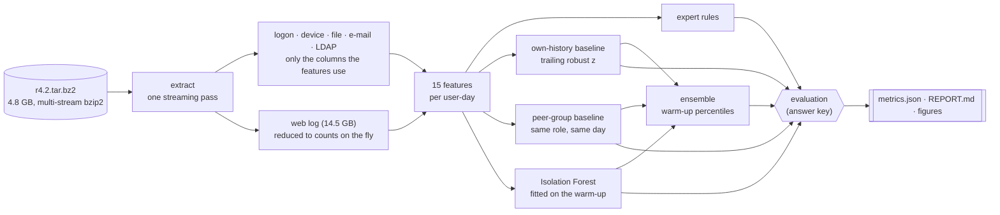

# Insider-threat UEBA on CERT r4.2

[](https://github.com/hugo-kte/insider-threat-ueba/actions/workflows/ci.yml)

-6f42c1)


User and entity behaviour analytics (UEBA) for insider threats, built on the CERT Insider Threat
Test Dataset r4.2: 1,000 simulated employees, 17 months of logon, removable-media, file, e-mail
and web logs, and 70 insiders planted by a red team in three scenarios. Five detectors, from
expert rules to robust own-history and peer-group baselines, an Isolation Forest and an
ensemble, score every employee every day. They are judged the way a SOC would use them: **an
analyst can review 5 or 10 people a day; which insiders would they have caught, and how
late?** No score looks ahead, nothing is tuned on the answer key, and every table comparing
detectors includes what random reviews would achieve. Along the way, the audit found a leak in
the dataset itself: the daily web request count gives the insiders away.

## Results

Scored period: 3 March 2010 to 17 May 2011 (441 days, 989 employees still active, 287,468
active user-days, 966 of them malicious: 0.34%), after a 60-day warm-up used only as history
and training data. Every number below is read from [`reports/metrics.json`](reports/metrics.json)
(full tables in [`reports/REPORT.md`](reports/REPORT.md)).

**An analyst's day: insiders caught with 10 reviews per day**

| Detector | Scenario 1 | Scenario 2 | Scenario 3 | **Total** | Median delay S1/S2/S3 (days) | User-level ROC-AUC |
|---|---:|---:|---:|---:|---|---:|
| Expert rules | 15/30 | 3/30 | 7/10 | 25/70 | 0 / 6 / 0 | 0.758 |
| **Own-history baseline** | 11/30 | **27/30** | **10/10** | **48/70** | 0 / 5 / 0 | 0.813 |
| Peer-group baseline | 4/30 | 2/30 | 2/10 | 8/70 | 0 / 14.5 / 0 | 0.827 |
| Isolation Forest | **23/30** | 8/30 | **10/10** | 41/70 | 0 / 30 / 0 | 0.868 |
| Ensemble | 9/30 | 19/30 | 8/10 | 36/70 | 0 / 15 / 0 | **0.873** |
| _Random reviews (expected)_ | 2.8 | 8.6 | 0.2 | 11.6 | | 0.500 |

Scenario 1: an employee who never worked late or used removable drives starts doing both and
uploads data to wikileaks.org. Scenario 2: an employee hunts for jobs, then steals data on a
thumb drive before leaving. Scenario 3: a disgruntled system administrator plants a keylogger
on his supervisor's machine and uses the stolen credentials to send a mass e-mail. With 5
reviews a day the totals are 18, 40, 7, 29 and 28 (random: 6.3).


**Who should be investigated?** Employees ranked by their most anomalous day:

| Detector | Insiders in top 10 | Top 25 | Top 50 | Top 100 |
|---|---:|---:|---:|---:|
| Expert rules | 5 | 17 | 27 | **42** |
| Own-history baseline | **9** | 15 | 24 | 30 |
| Peer-group baseline | 6 | 14 | 18 | 29 |
| Isolation Forest | 7 | **18** | **30** | 39 |
| Ensemble | **9** | 12 | 25 | 29 |
| _Random order (expected)_ | 0.7 | 1.8 | 3.5 | 7.1 |


**What this shows**

1. **Rules only see what they were written for.** The expert rules (after-hours drive use,
   after-hours logons, logons to an unusual PC) catch half of scenario 1 and 7 of the 10
   saboteurs, but only 3 of the 30 data thieves of scenario 2, who use their thumb drives
   during office hours. Against each person's own routine they stand out: the own-history
   baseline catches 27 of them, with a median delay of 5 days.
2. **No detector covers every scenario.** The own-history baseline catches the most insiders
   (48 of 70, four times what random reviews would). The Isolation Forest does better on
   scenario 1 (23 vs 11): a first-ever after-hours logon is only a z-score of 1 against a flat
   personal history (the +1 that stops a flat history from exploding also mutes a first event),
   whereas it is rare across everyone's warm-up.
3. **Averaging blunts the extremes a daily top 10 needs.** The ensemble has the best ranking
   metrics (user-level ROC-AUC 0.873, user-day average precision 0.020, six times the 0.0034
   base rate) yet catches fewer insiders than the own-history baseline alone (36 vs 48). A daily
   top 10 rewards being extreme on one view; a mean of percentiles rewards being high on all
   three. Comparing people with same-role colleagues on the same day is the weakest view
   (8 of 70).
4. **Almost every review is a false alarm.** For the best detector, 122 of 4,404 reviews (2.8%)
   land on a malicious user-day. The output is a lead list for a person, not a verdict.
5. **The definition of a catch is strict.** Only a review on a day with a labelled red-team
   event counts. The scenario-1 insider below tops the list on unlabelled days around the
   incident; counting any review between the incident's start and end adds 1 to 5 insiders per
   detector (column "During incident" in the report).


What the analyst sees on the review card, for the same three insiders on their best-ranked
malicious day (value, then the user's own median and the median of their role on that day).
Insiders are pseudonymised and days counted from their first malicious day, because the answer
key may be reported on but not redistributed:

| Scenario | Insider | Days after first malicious day | Ensemble rank | Top deviations |
|---:|---|---:|---:|---|
| 1 | A | 0 | #13 | after-hours logons 1 (0 / 0); weekend logons 1 (0 / 1.5); removable-drive connections 1 (0 / 0) |
| 2 | B | 38 | #2 | removable-drive connections 8 (2 / 0); files copied 3 (2 / 0); `.exe` files copied 1 (0 / 0) |
| 3 | C | 0 | #11 | never-visited web domains 3 (0 / 0); removable-drive connections 2 (0 / 0); e-mails sent 13 (11 / 11) |

## A leak in the dataset: the daily web request count

r4.2's web generator gives each user a fixed number of requests per day. During the warm-up,
**all 1,000 users make exactly the same number of requests on every day they browse** (86.1 on
average). Over the whole period the count changes for only 88 users, and they include **all 70
insiders**: injected red-team web events are the main thing that moves it. A detector fed this
count learns the simulator, not behaviour, so the count is computed for this audit but given to no
detector. The decision rests on the warm-up alone, where no insider is active; the answer key only
serves to show what the leak would have done:

| With the web request count as a feature | Insiders caught (10 reviews/day) | User-level ROC-AUC |
|---|---:|---:|
| Own-history baseline | 48 → 53 | 0.813 → 0.923 |
| Peer-group baseline | 8 → 8 | 0.827 → 0.853 |
| Isolation Forest | 41 → 40 | 0.868 → 0.812 |
| Ensemble | 36 → 43 | 0.873 → 0.882 |
| _Random reviews (expected)_ | 11.6 | 0.500 |

With it, the own-history baseline would catch all 30 scenario-2 insiders, most of them on their
very first malicious day (median delay 0 instead of 5), and more than double its reviews on
malicious days (285 instead of 122): impressive, and meaningless outside this simulator.
Never-visited domains are kept: 12% of active user-days after the warm-up include one, so they
behave like a real, noisy signal.

## How it works



**Single-pass extraction.** The archive holds about 16 GB of CSV, 14.5 GB of which is the web
log. `ueba extract` decompresses it once as a stream: `bz2.open` handed to `tarfile` in stream
mode, because the archive is multi-stream bzip2 and tarfile's own streaming mode `r|bz2` cannot
read past the first stream (it raises `EOFError`). Only what the features read reaches the disk:
the logon, device, file and e-mail logs and the monthly LDAP snapshots are cut down to the columns
the features use and written as Parquet, about 100 MB instead of 1.6 GB of CSV (no e-mail bodies,
no file contents, no names from the directory). The web log is reduced on the fly to two counts
per user-day (requests, and domains the user had never visited before), so no URL or page
content is stored. The psychometric file is skipped.

**Features.** One row per user and active day, with counts an analyst can read without a manual:

| Source | Features |
|---|---|
| Logons | logons; after hours (before 07:00 or from 19:00); on weekends; distinct PCs; logons to a PC other than the user's usual one (the most frequent during the warm-up) |
| Removable media | drive connections; after hours |
| File copies (to removable drives: every file event falls on a day with a drive connected) | files copied; `.exe` files; after hours |
| E-mail | e-mails sent; with an external recipient; attachments; total size |
| Web | domains never visited before by this user (the request count is audited, not used) |

**Detectors.** All five score every user-day:

* **Expert rules**: 2 × after-hours drive connections + after-hours file copies + 0.5 ×
  (after-hours logons + logons to an unusual PC). This is the SIEM baseline. The rules encode
  the publicly documented scenario behaviours, so they stand for a well-informed detection
  engineer, not a naive one.
* **Own-history baseline**: each feature as a robust z-score against the user's previous 30
  active days, `(x − median) / (IQR / 1.349 + 1)`; the day's score is the sum of the three
  largest positive deviations, so several mild signals beat a single spike. Median and IQR
  barely move after one malicious day, so an insider does not instantly become their own
  baseline.
* **Peer-group baseline**: the same robust z-score against colleagues with the same LDAP role
  (42 roles) on the same day.
* **Isolation Forest**: 300 trees on log counts plus the own-history z-scores, fitted on the
  warm-up only. A tree cannot split on a feature that never varied in its training data, which
  is why the forest and the baselines see different things.
* **Ensemble**: the mean of the own-history, peer and Isolation Forest scores, each converted
  to its percentile among the warm-up user-days.

**Review cards.** For any user-day, `explain()` lists the features furthest from the user's own
past and from their peers, with the medians they are compared with: what an analyst needs to
decide in a minute whether to open a case.

## Evaluation protocol

* **An analyst's day.** Every day the analyst reviews the 5 (or 10) highest-scoring employees.
  A user whose score is 0 (nothing fired) is never reviewed, and tied scores are ordered at
  random, never by user ID. An insider is caught on the first day they are reviewed *on one of
  their malicious days*; being flagged on an ordinary day does not count. The delay runs from
  the insider's first malicious day (medians are over the insiders caught).
* **Who should be investigated?** Employees ranked by their most anomalous day over the scored
  period: insiders among the top 10, 25, 50 and 100, plus ROC-AUC.
* **User-day ranking.** Average precision over all scored user-days (in the report).
* **Chance level, always.** Every table comparing detectors includes what a random ranking
  would achieve with the same budget, computed exactly: for the daily budget, the probability
  that random draws among each day's active employees hit at least one of the insider's malicious
  days.

**No look-ahead.** A score for day *t* uses only what was known at the end of day *t*. A test
(`test_scores_ignore_the_future`) recomputes every detector on data cut at day *t* and checks
that no earlier score changes.

* Own-history windows end the day before: today is never part of its own baseline.
* The Isolation Forest is fitted on the warm-up only, and the ensemble's percentile calibration
  is frozen after it (ranks over the whole period would let next year's scores move today's).
* Peer groups come from the first monthly LDAP snapshot. Every scenario ends with the insider
  leaving, and later snapshots drop the leavers, so they would leak who is about to go.
* Each user's usual PC is the most frequent one during the warm-up, and a "new" web domain is
  new relative to the user's own past.
* Warm-up days only serve as history and training data and are never scored; all 70 insiders
  start after the warm-up.

**Nothing was tuned on the answer key.** Window lengths, office hours, rule weights, forest
settings and the 60-day warm-up were fixed before the first evaluation run and have not changed
since. The one decision taken after looking at the data, dropping the web request count, uses
the warm-up only (no labels); its effect is reported above instead of hidden. The answer key is
read in one module (`groundtruth.py`) and only by the evaluation.

## Limitations

* **Synthetic data.** r4.2 is generated, and its insiders follow three scripted scenarios. Real
  insiders are rarer, more varied and quieter, and real logs are messier. The web-count leak is
  a reminder that a generator's shortcuts can masquerade as detection skill.
* **A dense needle.** 70 insiders among 1,000 employees (7%) is far more than any real
  organisation has; precision and the random baselines would be much lower in practice.
* **Scenario-aware features.** The features (after hours, removable media, unusual PCs, new
  domains) were chosen knowing the published scenario descriptions, the expert rules even more
  so. Another exfiltration path (cloud storage, slow e-mail leaks) would need new features.
* **One release.** No validation on the other CERT releases (r5.2, r6.2), which add scenarios
  and change behaviours.
* **A simple analyst model.** No alert suppression (a cleared user can come back every day), no
  case correlation across days, the same budget on weekends.
* **Peer statistics include the user.** A user's own value counts in their role's daily median
  and IQR, which damps the peer-group baseline, most of all in small roles.

## Ethics and privacy

Insider-threat programmes monitor colleagues, so the design choices matter as much as the
scores.

* **Proportionality.** The dataset ships Big Five personality scores for every employee. They
  are deliberately unused: behaviour tied to the threat (data leaving on removable media,
  unusual access) is enough, and profiling personalities is neither necessary nor proportionate.
* **Data minimisation.** Extraction keeps only the columns the features use: no URL, web page,
  e-mail body or file content is ever written to disk, and the directory snapshots keep user ID,
  role and department, not names or e-mail addresses. Recipient addresses are kept only to tell
  internal from external mail; the e-mail features are counts, sizes and that distinction.
* **Pseudonymous IDs.** Everything runs on user IDs; identifying a person belongs to a later,
  authorised step of an investigation.
* **Human review.** The output is a review queue, not a verdict. With 97% of reviews landing on
  innocent user-days even for the best detector, no automated action should follow from a
  score.
* **Lawful basis.** Monitoring employees needs a legal basis and transparency towards staff and,
  in the EU, usually a data protection impact assessment and works-council involvement. This
  project only demonstrates the analytics.

## Quickstart

```bash
git clone https://github.com/hugo-kte/insider-threat-ueba.git && cd insider-threat-ueba
make install     # .venv with the package and dev tools
make download    # CERT r4.2 (4.8 GB) and the answer key from KiltHub, MD5-checked
make extract     # one streaming pass over the archive: 35 to 55 min, single-threaded
make evaluate    # features, detectors, evaluation -> reports/ (about 2 min)
make test        # 17 tests on a miniature archive in the CERT layout, no download needed
```

```text
ueba extract  [--archive data/raw/r4.2.tar.bz2] [--answers data/raw/answers.tar.bz2]
              [--out-dir data/extracted] [--answers-dir data/answers]
ueba evaluate [--extracted data/extracted] [--answers data/answers/answers]
              [--out-dir reports] [--warmup-days 60]
```

Disk: 4.8 GB for the archive plus about 100 MB for the extracted columns (the decompressed logs
never touch the disk).

## Project layout

```text
src/ueba/
├── extract.py      single streaming pass over the archive: only the columns used, web counts
├── features.py     user-day features, LDAP roles from the first snapshot, simulator artifacts
├── detectors.py    expert rules, own-history and peer robust z-scores, Isolation Forest,
│                   ensemble, review cards
├── groundtruth.py  insiders and malicious user-days from the answer key
├── evaluate.py     analyst's daily budget, user-level top k, user-day AP, random baselines,
│                   web-count audit
├── pipeline.py     features (cached) -> scores -> metrics.json, REPORT.md, figures
└── report.py, plots.py, cli.py
reports/            metrics.json, REPORT.md, figures/ (regenerated by `make evaluate`)
tests/              miniature archive in the CERT layout (multi-stream bzip2), no download
```

## Data, license and citation

The CERT Insider Threat Test Dataset is published by Carnegie Mellon University's Software
Engineering Institute on KiltHub under CC BY 4.0. It is synthetic: no real person's activity is
in it. The files also carry ExactData's end-user agreement, which allows reports on the data but
not redistribution, so neither the dataset nor its answer key is included here: `reports/` holds
aggregate results plus the daily counts of the three example review cards, whose insiders are
pseudonymised and whose days are counted from the incident. Those counts are derived from the
test data files: Copyright © 2011 ExactData, LLC, All Rights Reserved.

* Lindauer, B. (2020). *Insider Threat Test Dataset*. Carnegie Mellon University.
  [doi:10.1184/R1/12841247.v1](https://doi.org/10.1184/R1/12841247.v1)
* Glasser, J. and Lindauer, B. (2013). *Bridging the Gap: A Pragmatic Approach to Generating
  Insider Threat Data*. IEEE Security and Privacy Workshops.

Code: [MIT](LICENSE).
