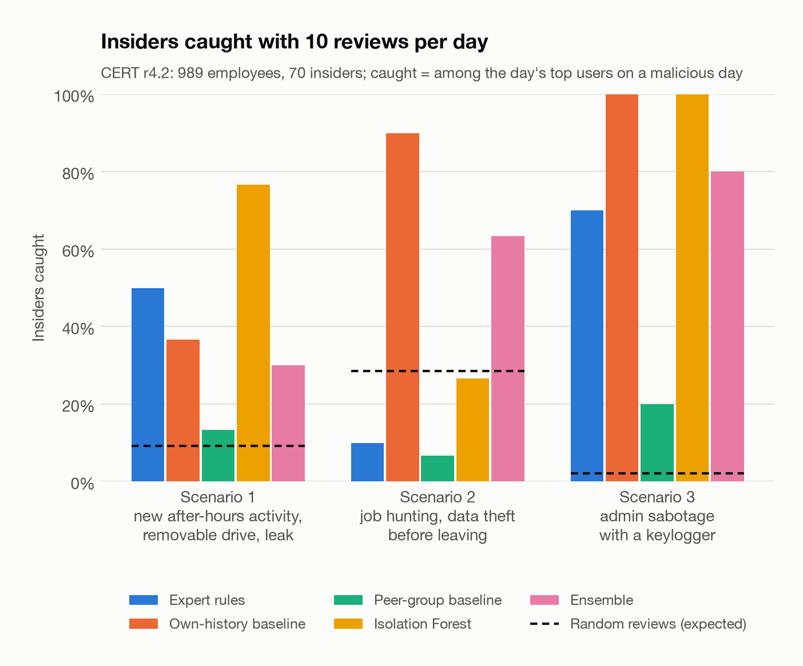
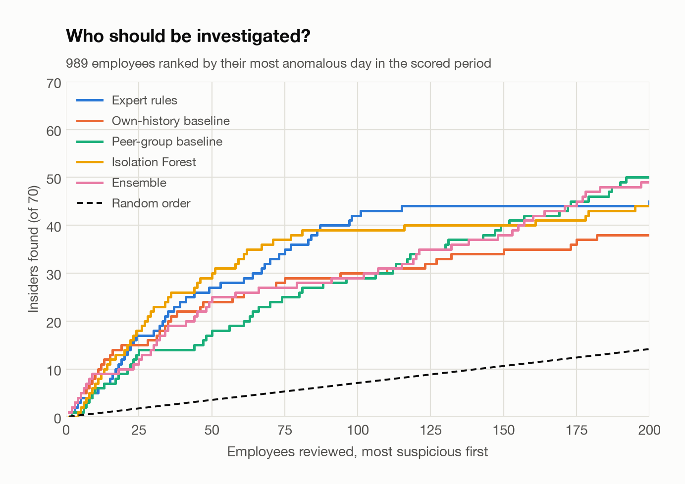
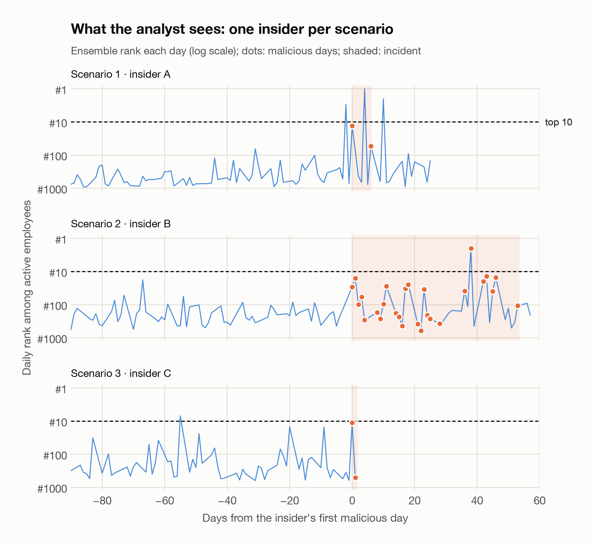

# UEBA evaluation report (CERT r4.2)

_Generated 2026-10-13T12:09:08+00:00. Scored period 2010-03-03 to 2011-05-17, after a 60-day warm-up used only as history and training data._

989 users (70 insiders), 441 days, 287,468 active user-days, of which 966 malicious (0.34%).

## Who should be investigated? (user level, 70 insiders among 989 employees)

Employees ranked by their highest daily score: insiders among the first k.

| Detector | ROC-AUC | Top 10 | Top 25 | Top 50 | Top 100 |
|---|---:|---:|---:|---:|---:|
| Expert rules | 0.758 | 5 | 17 | 27 | 42 |
| Own-history baseline | 0.813 | 9 | 15 | 24 | 30 |
| Peer-group baseline | 0.827 | 6 | 14 | 18 | 29 |
| Isolation Forest | 0.868 | 7 | 18 | 30 | 39 |
| Ensemble | 0.873 | 9 | 12 | 25 | 29 |
| _Random order (expected)_ | 0.500 | 0.7 | 1.8 | 3.5 | 7.1 |

## An analyst's day: insiders caught with a fixed number of reviews per day

Every day the analyst reviews the top-scoring users; an insider is caught when reviewed on one of their malicious days. Delay: days from the insider's first malicious day. During incident (lenient): reviewed on any day between the incident's start and end.

| Detector | Reviews/day | Scenario 1 | Scenario 2 | Scenario 3 | Total | Median delay S1/S2/S3 (days) | During incident |
|---|---:|---:|---:|---:|---:|---|---:|
| Expert rules | 5 | 13/30 | 2/30 | 3/10 | 18/70 | 0/29.5/0 | 21/70 |
| Expert rules | 10 | 15/30 | 3/30 | 7/10 | 25/70 | 0/6/0 | 29/70 |
| Own-history baseline | 5 | 8/30 | 24/30 | 8/10 | 40/70 | 0/7/0 | 45/70 |
| Own-history baseline | 10 | 11/30 | 27/30 | 10/10 | 48/70 | 0/5/0 | 52/70 |
| Peer-group baseline | 5 | 4/30 | 1/30 | 2/10 | 7/70 | 0/24/0 | 8/70 |
| Peer-group baseline | 10 | 4/30 | 2/30 | 2/10 | 8/70 | 0/14.5/0 | 9/70 |
| Isolation Forest | 5 | 17/30 | 2/30 | 10/10 | 29/70 | 0/7/0 | 32/70 |
| Isolation Forest | 10 | 23/30 | 8/30 | 10/10 | 41/70 | 0/30/0 | 43/70 |
| Ensemble | 5 | 9/30 | 12/30 | 7/10 | 28/70 | 0/32.5/0 | 33/70 |
| Ensemble | 10 | 9/30 | 19/30 | 8/10 | 36/70 | 0/15/0 | 41/70 |
| _Random reviews (expected)_ | 5 | 1.4 | 4.7 | 0.1 | 6.3 | | |
| _Random reviews (expected)_ | 10 | 2.8 | 8.6 | 0.2 | 11.6 | | |

## User-day ranking

| Detector | Average precision | ROC-AUC |
|---|---:|---:|
| Expert rules | 0.007 | 0.546 |
| Own-history baseline | 0.018 | 0.768 |
| Peer-group baseline | 0.012 | 0.823 |
| Isolation Forest | 0.014 | 0.829 |
| Ensemble | 0.020 | 0.852 |
| _Random order (expected)_ | 0.0034 | 0.500 |

## What the analyst sees

The first insider of each scenario in the answer key, on their best-ranked malicious day: the three features furthest from their own past and from their peers. The answer key may be reported on but not redistributed, so insiders are pseudonymised and days counted from their first malicious day.

| Scenario | Insider | Days after first malicious day | Ensemble rank | Top deviations: value (own median / peer median) |
|---:|---|---:|---:|---|
| 1 | A | 0 | #13 | after-hours logons 1 (0 / 0); weekend logons 1 (0 / 1.5); removable-drive connections 1 (0 / 0) |
| 2 | B | 38 | #2 | removable-drive connections 8 (2 / 0); files copied 3 (2 / 0); .exe files copied 1 (0 / 0) |
| 3 | C | 0 | #11 | never-visited web domains 3 (0 / 0); removable-drive connections 2 (0 / 0); e-mails sent 13 (11 / 11) |

_Daily counts derived from the CERT r4.2 test data files: Copyright © 2011 ExactData, LLC, All Rights Reserved._

## A leak in the dataset: the daily web request count

During the warm-up, 1,000 of 1,000 users make exactly the same number of web requests on every day they browse (86.1 on average). Over the whole period the count changes for only 88 users, including 70 of the 70 insiders: injected red-team web events are the main thing that moves it. The count is therefore excluded from every detector. For the record, this is what it would do:

| Detector | Insiders caught, 10 reviews/day | ROC-AUC (user level) |
|---|---:|---:|
| Own-history baseline | 48/70 -> 53/70 | 0.813 -> 0.923 |
| Peer-group baseline | 8/70 -> 8/70 | 0.827 -> 0.853 |
| Isolation Forest | 41/70 -> 40/70 | 0.868 -> 0.812 |
| Ensemble | 36/70 -> 43/70 | 0.873 -> 0.882 |
| _Random reviews (expected)_ | 11.6 | 0.500 |
